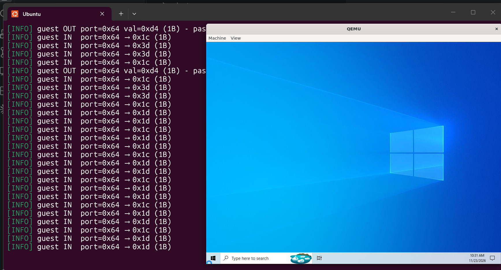

```
 __     ____  __ ____  ____
 \ \   / /  \/  | __ )|  _ \
  \ \ / /| |\/| |  _ \| |_) |
   \ V / | |  | | |_) |  _ <
    \_/  |_|  |_|____/|_| \_\
                      by: Itai Rosenperl
```

# Bare-Metal Hypervisor Rootkit


-critical)


**VMBR** is a bare-metal **Type-1 hypervisor** — it isn't a program that runs *on* an
OS, it *is* the thing the CPU boots into, and everything else runs as its guest. It
starts as a Multiboot2 kernel loaded by GRUB in 32-bit protected mode, walks itself
all the way up to 64-bit long mode, turns on Intel **VT-x** with **EPT**, and launches
a guest that it fully controls through VM exits.

No libc, no RTOS, no framework. Just C and x86 assembly talking to the hardware
directly, built one iteration at a time against the Intel SDM.

> **Current state:** boots Windows 10 all the way to the sign-in screen and desktop,
> on a single CPU, with the hypervisor's own memory protected from the guest at the
> EPT layer. SMP bring-up for the guest is in progress.



*Windows 10 desktop running inside VMBR (right) while the hypervisor logs every port
I/O the guest performs over its serial console (left). Everything the guest does
goes through a VM exit the hypervisor handles.*

---

## The boot journey

Each arrow is a mode switch or a capability the previous stage made possible — and a
place where getting one bit wrong triple-faults the machine with no debugger to catch it.

```
 GRUB (Multiboot2)
      │  loads the kernel at 256 MB, 32-bit protected mode
      ▼
 _start (boot.asm) ──► BSP vs AP split (IA32_APIC_BASE bit 8)
      │
      │                          ┌─── APs: wait on bsp_ready, grab own stack ──┐
      ▼                          ▼                                              │
 BSP: paging (8 GB identity) ──► GDT ──► enter long mode ◄──────────────────────┘
      │                                                        │
      │                              far-jump into 64-bit code ▼
      ▼                                     kernel_main (C) / ap_main (C)
 BIOS E820 map  ◄── long-mode→real-mode trampoline (bios_call.asm)
      │
      ▼
 ACPI → MADT → CPU count ──► Local APIC INIT-SIPI wakes the APs that firmware parked
      │
      ▼
 bump allocator ──► host paging rebuilt (8 GB) ──► VMXON ──► VMCS ──► EPT (identity,
      │                                                                 MTRR-typed,
      ▼                                                                 VMM pages hidden)
 install guest hooks (E820, INT 13h, INT 15h) ──► VMLAUNCH ──► 🫥 guest runs (Windows 10)
                                                                      │
                               every CPUID / MSR / CR / VMCALL / port I/O ─┤
                                                                      ▼
                                              VM-exit handler ──► VMRESUME ──► … 
```

Run it and the serial console shows the whole chain reporting in, ending with the
guest printing from *inside* the VM and the hypervisor servicing its exits.

---

## What's interesting in here

A guided tour of the parts that are more than boilerplate.

### 1. Catching a VM exit without destroying the guest

When the CPU takes a VM exit it saves **none** of the guest's general-purpose
registers — they still hold the guest's values, and the first line of compiled C would
clobber them. So the host's entry point is hand-written assembly that spills all 15
GPRs first, and only then calls into C. It's also where the classic 16-byte stack
alignment trap lives.

```asm
; src/vmexit_entry.asm — this is HOST_RIP: the CPU jumps straight here on every exit
vmexit_entry:
    push rax
    push rcx
    ...                         ; all 15 GPRs — order defines struct GuestRegisters
    push r15

    mov rdi, rsp                ; GuestRegisters * — first argument to the handler
    mov rbp, rsp                ; rbp is callee-saved, so C preserves it across the call
    and rsp, -16                ; 16-byte align, per the SysV ABI — skip this and GCC
    call handleVmExit           ; #GPs on its first SSE-aligned access, nowhere near here
    mov rsp, rbp

    pop r15
    ...                         ; restore the (possibly modified) registers
    pop rax
    vmresume                    ; back into the guest; never returns on success
```

### 2. Making the hypervisor invisible

The guest must not be able to tell it's virtualized, or it behaves differently. Every
`CPUID` exits to the host, which runs the real instruction and then **masks out** the
bits that would give the game away — VT-x, SMX, and the hypervisor-present bit:

```c
// src/vmexit.c — handleCpuid()
cpuidEx(leaf, subleaf, &eax, &ebx, &ecx, &edx);     // the real answer...
if (leaf == CPUID_FEATURES_LEAF) {
    ecx &= ~(CPUID_1_ECX_VMX | CPUID_1_ECX_SMX | CPUID_1_ECX_HYPERVISOR);  // ...minus the tells
}
```

Any VMX instruction the guest tries (`vmxon`, `vmcall`, …) is answered with an
injected `#UD` — exactly what a CPU without VT-x would do.

### 3. Hiding the hypervisor's own memory from the guest — with a hypercall

The guest asks the BIOS "what memory exists?" via `INT 15h, E820`. VMBR splices a tiny
real-mode stub into the guest's interrupt table; the stub issues a **`VMCALL`** carrying
a magic marker, and the host answers in C — handing back the real memory map with the
hypervisor's own pages rewritten as *reserved*, so the guest never loads anything on
top of them.

```asm
; src/int15_hook.asm — runs in the guest, in real mode, as its INT 15h handler
    cmp eax, 0xE820
    jne .chain                  ; not our call? hand it to the real BIOS
    mov ebp, 0x564D4252         ; "VMBR" — lets the host tell our hypercall from a guest probe
    vmcall                      ; → trap to the host, which fills in the answer
    sti
    retf 2                      ; return to the caller keeping CF (status), dropping saved flags
```

```c
// src/hooks.c — handleHypercall(): the host side of that VMCALL
if ((uint32_t)ctx->registers->rbp != VMBR_HYPERCALL_MAGIC)
    return 0;                   // not ours → caller injects #UD
```

The map comes out carved exactly where the VMM lives — the host logs both protected
ranges (kernel image + allocations), and the guest's own `E820` walk shows the hole:

```
# host, while building the filtered map:
guest E820 map built: 8 entries (2 VMM ranges carved out as reserved)
  protecting 100000-116000       <-- the hypervisor's kernel image
  protecting 7f7c9000-7ffe0000   <-- its allocations (EPT tables, stacks, …)

# the guest, walking INT 15h E820 itself:
 00100000  reserved              <-- carved out; the guest won't touch it
 00116000  usable
```

### 4. EPT, typed from the real MTRRs

A second layer of page tables (`ept.c`) identity-maps the first 8 GB for the guest at
4 KB granularity, and sets each page's memory type from the host's MTRRs — so guest RAM
stays write-back while the VGA/APIC/PCI holes stay uncacheable, instead of guessing.

### 5. Hiding the hypervisor's own pages at the EPT layer

The E820 hook asks the guest to be polite — "please don't use this memory." Windows
doesn't listen. Its `bootmgr` and `winload` hard-code specific physical addresses as
loader scratch and write to them regardless of what the E820 says, which used to
silently corrupt VMBR itself (the next VM exit then ran on scrambled host code and
nested KVM didn't forward the resulting triple fault back to us — QEMU just exited
with nothing in the log).

Enforcement had to move down a layer: before `VMLAUNCH`, `hideEptRange()` walks the
EPT for every VMM-owned range (kernel image, allocator footprint) and clears
`read`/`write`/`execute` on each PTE. The guest can still *see* those guest-physical
addresses in its own page tables, but the moment it dereferences one the CPU raises
an EPT violation and exits straight to us with the faulting address.

```c
// src/ept.c — hideEptRange(): make VMM memory unmappable to the guest
for (uint64_t addr = pageStart; addr < pageEnd; addr += PAGE_SIZE) {
    EptPageEntry *pte = /* walk PML4 → PDPT → PD → PT */ ... ;
    pte->fields.read    = 0;
    pte->fields.write   = 0;
    pte->fields.execute = 0;
}
```

Plus, the kernel was relinked at **256 MB** (`src/linker_script.ld`) — out of the
1 MB neighbourhood every Windows loader hard-codes as its own.

### 6. Observing the firmware boot chain through an `INT 13h` hook

VMBR can't service `INT 13h` disk reads itself once `VMXON` is running (reaching
real mode needs `CR0.PE=0`, which VMX operation forbids), so the hook is an
**observe-and-chain** stub: on every guest `INT 13h`, bounce into the host with a
`VMCALL` carrying a disk-specific magic, let the host log the LBA/count/buffer the
guest asked for, and then jump straight to the original BIOS handler the IVT held
before the hook was installed.

That's how the serial log in the screenshot above shows every sector the guest
reads during the whole boot chain — MBR, VBR, MFT, `bootmgr`, `winload.exe`,
`ntoskrnl` — without the hypervisor ever actually servicing the disk.

---

## Build & run

```bash
# one-time toolchain (Ubuntu)
sudo apt install nasm gcc-multilib grub-pc-bin grub-common xorriso mtools qemu-system-x86

make            # build build/vmbr.iso (incremental)
make run        # boot it in QEMU on the serial console, in this terminal
make debug      # same, but paused with a GDB stub on :1234
make clean      # wipe build/
```

Because VMBR is *itself* a hypervisor, QEMU has to give it real VT-x — hence
`-enable-kvm -cpu host` (nested virtualization). You need `/dev/kvm` usable and the
host's `kvm_intel`/`kvm_amd` reporting `nested: Y`.

> New `.c` / `.asm` files anywhere under `src/` are picked up automatically by the
> Makefile — no edits needed as the project grows.

---

## Running with a Windows guest

By default `make run` boots the small built-in real-mode test guest (see
`src/guest.asm`). To run **Windows 10** as the guest instead, you need a
bootable Windows disk image. VMBR doesn't ship one: the image is multi-GB
and the Windows media is Microsoft's to distribute, not ours. Each user
installs their own with the helper script.

```bash
# 1. Point the helper at a fresh ISO (see below) and let it install
#    Windows into a qcow2 disk in plain QEMU (no VMBR yet):
tools/install_windows.sh
# ...click through the installer, reach the desktop, shut Windows
# down from inside the VM, then close QEMU.

# 2. Boot that installed disk UNDER VMBR:
make run     DISK_IMG=Win10/win10.qcow2 DISK_FMT=qcow2 MEM=8G
make run-gui DISK_IMG=Win10/win10.qcow2 DISK_FMT=qcow2 MEM=8G SMP=4
```

The script creates `Win10/win10.qcow2` (~40 GB sparse, grows on demand)
and expects a Windows install ISO at `Win10/Windows.iso`. Both paths are
in the project's `.gitignore` - they stay on your machine only.

### Getting the Windows 10 ISO legally and for free

Microsoft publishes a direct ISO download on its official site. The
page's behaviour depends on the browser's User-Agent:

1. **Linux / macOS**: open <https://www.microsoft.com/en-us/software-download/windows10ISO>
   and you'll see the "Download Windows 10 Disk Image (ISO)" dropdowns.
2. **Windows**: the same page hides the ISO option and pushes the Media
   Creation Tool at you. Two workarounds:
   - Open the URL in your browser's mobile-device emulation (Chrome/Edge
     DevTools → *Toggle device toolbar*; Firefox → *Responsive Design
     Mode*) — the page then shows the Linux-style dropdowns.
   - Or download `MediaCreationTool22H2.exe` from the same page, run it,
     pick *"Create installation media (ISO file)"*, and save the result.
3. In the dropdowns pick **"Windows 10 (multi-edition ISO)"** → confirm
   → your language → confirm → click **64-bit Download**. The file is
   ~5-6 GB.
4. Save it as `Win10/Windows.iso` in this repo (create the folder first:
   `mkdir -p Win10`). Then re-run `tools/install_windows.sh`.

The install script also prints these steps if the ISO is missing.

---

## Project layout

```
src/
  boot.asm            Multiboot2 header + _start; BSP vs AP split
  paging.asm          8 GB identity page tables (host, boot-time)
  gdt.asm             flat GDT with 16/32/64-bit descriptors + TSS
  long_mode.asm       the switch into 64-bit mode (BSP / AP branches)
  bios_call.asm       long-mode → real-mode trampoline (for BIOS INT calls)
  memory_map.asm      BIOS E820 loader
  kernel.c            kernel_main — boots the VMM
  memory.c            page-aligned bump allocator + VMM reserved-range tracking
  host_paging.c       rebuilds host page tables and switches CR3
  vmx.c               VMXON, VMCS setup, EPT wiring, VMLAUNCH
  vmcs_fields.h       VMCS field encodings (SDM Appendix B)
  ept.c               identity EPT (8 GB), memory types from the MTRRs,
                      per-page R/W/X hiding of the VMM's own range
  vmexit_entry.asm    the VM-exit stub (saves guest state, resumes)
  vmexit.c            VM-exit dispatcher + per-reason handlers
  hooks.c             guest-facing hooks (E820 and INT 13h observers)
  int15_hook.asm      real-mode stub spliced into the guest's IVT (INT 15h)
  int13_hook.asm      observe-and-chain INT 13h hook (disk access)
  disk.c              high-level BIOS int 0x13 driver (DAP, bounce buffer)
  acpi.c              RSDP → RSDT/XSDT → MADT CPU count
  smp.c               Local APIC INIT-SIPI-SIPI to wake the APs
  ap_trampoline.asm   the real-mode stub each AP wakes up into
  ap.c                ap_main — per-AP long-mode entry
  guest.asm           the real-mode test guest (used when no disk is given)
include/              the matching headers
tools/
  install_windows.sh  install Windows into a qcow2 disk in plain QEMU
```

---

## Status & roadmap

**Working today** — boots **Windows 10** as the guest, on a single CPU, with the
hypervisor's own memory inaccessible to it:

- [x] Multiboot2 / GRUB / QEMU boot chain
- [x] 8 GB-covering paging, GDT, long mode, BIOS E820, bump allocator
- [x] `VMXON` → `VMCS` → `EPT` (MTRR-typed, 8 GB) → unrestricted guest → `VMLAUNCH`
- [x] VM-exit framework: `CPUID`, `RDMSR`/`WRMSR` (MSR bitmap), `MOV CR`, `INVD`,
      `XSETBV`, `GETSEC`/`RSM`, all VMX instructions → `#UD`
- [x] Guest mode-switch tracking (real → protected → long) via the CR0/EFER exits
- [x] `INT 15h`/E820 memory hook over `VMCALL` — the VMM hides its own memory
- [x] Real BIOS `INT 13h` disk driver, MBR scan, guest booted from the found MBR
- [x] `INT 13h` observe-and-chain hook — every guest disk access logged
- [x] Three reset-capable I/O ports (`0x64`, `0x92`, `0xCF9`) trapped so the guest
      can't just restart the machine out from under us
- [x] VMBR's own pages hidden from the guest at the EPT layer — a Windows write to
      the kernel range exits as an EPT violation instead of silently corrupting us
- [x] Windows 10 boots to the sign-in screen and the desktop on a single CPU
- [x] ACPI table walk (RSDP → RSDT / XSDT → MADT) — knows how many CPUs there are
- [x] Local APIC `INIT`-`SIPI`-`SIPI` wake-up — all APs reach a shared
      low-memory trampoline (phase A of iteration 8)

**In progress — Iteration 8: SMP**

- [ ] AP trampoline does the full real → protected → long-mode transition into
      `ap_main` (phase B)
- [ ] Each AP does its own `VMXON` + `VMCS` with the initial guest state the
      SDM specifies for a non-BSP CPU (phase B)
- [ ] `INIT`/`SIPI` VM-exit handlers so Windows waking its own APs is translated
      into VMBR waking the AP's guest VMCS (phases C/D)
- [ ] Windows seeing (and using) every logical CPU the host reports

**Beyond iteration 8**

- [ ] Re-inject an event interrupted mid-delivery (`IDT_VECTORING_INFO`)
- [ ] x2APIC virtualization (MSR-based APIC) for the guest
- [ ] Nest VMBR inside itself — guest hypervisor support

---

## War stories

Hard-won bugs this project has already paid for, kept here because every one of them
cost hours and none showed up where you'd look:

- **A real-mode BIOS `INT` call silently triple-faulting** — leaving protected/long
  mode doesn't reset `IDTR`, so every BIOS interrupt dispatched through a stale,
  non-real-mode IDT. Fix: `lidt` a real-mode IVT descriptor first.
- **A VM entry failing with `0x80000021` while every field looked valid alone** — the
  TR segment's granularity bit disagreed with its limit. VMX cross-checks *pairs* of
  fields; each was fine, the pair wasn't.
- **`VMXON` faulting with no error to read** — `CR0`/`CR4` must satisfy the
  `IA32_VMX_CR*_FIXED0/1` MSRs, not just `CR4.VMXE`.
- **A compiled C function `#GP`-ing on entry with the stack "looking fine"** — a
  32→64-bit `call` that never returns skews `RSP` by 4 bytes; the SysV ABI's 16-byte
  alignment requirement does the rest. (It's why `and rsp, -16` guards every C call
  from assembly.)
- **The bump allocator triple-faulting right after `== Host Paging ==`** — with
  QEMU `-m 4G` (or more) the E820 ends with a usable region *above* 4 GB, which
  the "last usable wins" picker happily chose. The boot page tables map only the
  first 4 GB, so the first `memset()` on that allocation faulted through a
  never-mapped PDE. Fix: `ALLOC_LIMIT` clamps every region to the paging ceiling.
- **A Windows guest silently hanging right after it read LBA 2050** — our INT 13h
  observe stub lived at 0x8000-0x81FF, and Windows's NTFS VBR is 16 sectors
  loaded contiguously at 0x7C00, so LBA 2050 lands exactly on the stub. The IVT
  still pointed there, so the next `int 13h` jumped into random VBR bytes and
  the guest just stopped making progress. Moved the stubs to 0x9F000 (above the
  VBR's reach, below SeaBIOS's EBDA) and marked the page reserved in the guest E820.
- **Windows booting almost all the way through protected mode and then QEMU
  just exiting, no VM-exit, no triple-fault, nothing in the log** — Windows's
  bootmgr and winload hard-code 0x100000 as their own loader scratch and write
  there regardless of what the E820 says. The hypervisor used to *link* at 1 MB,
  so the first write corrupted VMBR's own code, the next VM exit ran on
  garbage, and nested KVM didn't forward the resulting triple fault back to us.
  Moved VMBR to 256 MB and now unmap its pages from the EPT so Windows gets a
  legible EPT violation instead of taking us down with it.
- **`MEM=8G` reproducing the original "silent crash right after Host Paging"** —
  `setup_paging` in `paging.asm` is 32-bit code that was walking the physical
  address in `eax` alone, so every 2 MB PDE past the 4 GB boundary wrapped back
  to 0 and shadow-mapped the first GB. Carry the high 32 bits in `esi`
  (`adc esi, 0` after each `add eax, LARGE_PAGE_SIZE`) and write them into the
  high dword of each PDE.
- **SeaBIOS leaves non-BSP cores in wait-for-SIPI, not running our code** —
  checking `IA32_APIC_BASE` bit 8 in boot.asm was enough to *park* APs that do
  reach it, but SeaBIOS never lets them get there. Phase A of iteration 8 copies
  a real-mode stub to 0x8000 and uses the Local APIC's ICR to deliver
  `INIT`-`SIPI`-`SIPI` to each AP the ACPI MADT reports.

---

*Personal / course project. Built against the Intel® 64 and IA-32 Architectures
Software Developer's Manual, Volume 3.*
