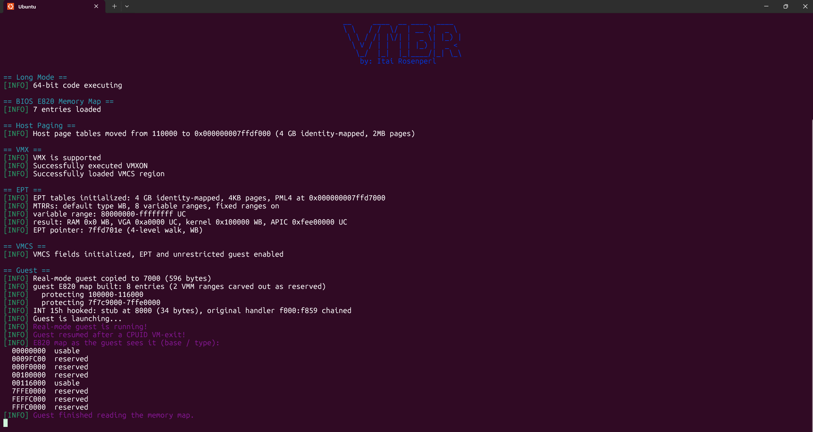

```
 __     ____  __ ____  ____
 \ \   / /  \/  | __ )|  _ \
  \ \ / /| |\/| |  _ \| |_) |
   \ V / | |  | | |_) |  _ <
    \_/  |_|  |_|____/|_| \_\
                      by: Itai Rosenperl
```

# Bare-Metal Hypervisor Rootkit


-critical)


**VMBR** is a bare-metal **Type-1 hypervisor** — it isn't a program that runs *on* an
OS, it *is* the thing the CPU boots into, and everything else runs as its guest. It
starts as a Multiboot2 kernel loaded by GRUB in 32-bit protected mode, walks itself
all the way up to 64-bit long mode, turns on Intel **VT-x** with **EPT**, and launches
a guest that it fully controls through VM exits.

No libc, no RTOS, no framework. Just C and x86 assembly talking to the hardware
directly, built one iteration at a time against the Intel SDM.

> **End goal:** boot Windows as the guest and protect the hypervisor's own memory
> from it using EPT. Everything below is the road there.



*The full boot chain reporting in over the serial console — ending with the guest
running inside the VM and reading the (hooked) memory map, the hypervisor's own pages
shown as `reserved`.*

---

## The boot journey

Each arrow is a mode switch or a capability the previous stage made possible — and a
place where getting one bit wrong triple-faults the machine with no debugger to catch it.

```
 GRUB (Multiboot2)
      │  loads the kernel at 1 MB, 32-bit protected mode
      ▼
 _start (boot.asm) ──► paging (4 GB identity) ──► GDT ──► enter long mode
      │                                                        │
      │                              far-jump into 64-bit code ▼
      ▼                                               kernel_main (C)
 BIOS E820 map  ◄── long-mode→real-mode trampoline (bios_call.asm)
      │
      ▼
 bump allocator ──► host paging rebuilt ──► VMXON ──► VMCS ──► EPT (identity, MTRR-typed)
      │                                                               │
      ▼                                                               ▼
 install E820 hook ──────────────────────────────► VMLAUNCH ──► 🫥 guest runs
                                                                      │
                                   every CPUID / MSR / CR / VMCALL ───┤
                                                                      ▼
                                              VM-exit handler ──► VMRESUME ──► … 
```

Run it and the serial console shows the whole chain reporting in, ending with the
guest printing from *inside* the VM and the hypervisor servicing its exits.

---

## What's interesting in here

A guided tour of the parts that are more than boilerplate.

### 1. Catching a VM exit without destroying the guest

When the CPU takes a VM exit it saves **none** of the guest's general-purpose
registers — they still hold the guest's values, and the first line of compiled C would
clobber them. So the host's entry point is hand-written assembly that spills all 15
GPRs first, and only then calls into C. It's also where the classic 16-byte stack
alignment trap lives.

```asm
; src/vmexit_entry.asm — this is HOST_RIP: the CPU jumps straight here on every exit
vmexit_entry:
    push rax
    push rcx
    ...                         ; all 15 GPRs — order defines struct GuestRegisters
    push r15

    mov rdi, rsp                ; GuestRegisters * — first argument to the handler
    mov rbp, rsp                ; rbp is callee-saved, so C preserves it across the call
    and rsp, -16                ; 16-byte align, per the SysV ABI — skip this and GCC
    call handleVmExit           ; #GPs on its first SSE-aligned access, nowhere near here
    mov rsp, rbp

    pop r15
    ...                         ; restore the (possibly modified) registers
    pop rax
    vmresume                    ; back into the guest; never returns on success
```

### 2. Making the hypervisor invisible

The guest must not be able to tell it's virtualized, or it behaves differently. Every
`CPUID` exits to the host, which runs the real instruction and then **masks out** the
bits that would give the game away — VT-x, SMX, and the hypervisor-present bit:

```c
// src/vmexit.c — handleCpuid()
cpuidEx(leaf, subleaf, &eax, &ebx, &ecx, &edx);     // the real answer...
if (leaf == CPUID_FEATURES_LEAF) {
    ecx &= ~(CPUID_1_ECX_VMX | CPUID_1_ECX_SMX | CPUID_1_ECX_HYPERVISOR);  // ...minus the tells
}
```

Any VMX instruction the guest tries (`vmxon`, `vmcall`, …) is answered with an
injected `#UD` — exactly what a CPU without VT-x would do.

### 3. Hiding the hypervisor's own memory from the guest — with a hypercall

The guest asks the BIOS "what memory exists?" via `INT 15h, E820`. VMBR splices a tiny
real-mode stub into the guest's interrupt table; the stub issues a **`VMCALL`** carrying
a magic marker, and the host answers in C — handing back the real memory map with the
hypervisor's own pages rewritten as *reserved*, so the guest never loads anything on
top of them.

```asm
; src/int15_hook.asm — runs in the guest, in real mode, as its INT 15h handler
    cmp eax, 0xE820
    jne .chain                  ; not our call? hand it to the real BIOS
    mov ebp, 0x564D4252         ; "VMBR" — lets the host tell our hypercall from a guest probe
    vmcall                      ; → trap to the host, which fills in the answer
    sti
    retf 2                      ; return to the caller keeping CF (status), dropping saved flags
```

```c
// src/hooks.c — handleHypercall(): the host side of that VMCALL
if ((uint32_t)ctx->registers->rbp != VMBR_HYPERCALL_MAGIC)
    return 0;                   // not ours → caller injects #UD
```

The map comes out carved exactly where the VMM lives — the host logs both protected
ranges (kernel image + allocations), and the guest's own `E820` walk shows the hole:

```
# host, while building the filtered map:
guest E820 map built: 8 entries (2 VMM ranges carved out as reserved)
  protecting 100000-116000       <-- the hypervisor's kernel image
  protecting 7f7c9000-7ffe0000   <-- its allocations (EPT tables, stacks, …)

# the guest, walking INT 15h E820 itself:
 00100000  reserved              <-- carved out; the guest won't touch it
 00116000  usable
```

### 4. EPT, typed from the real MTRRs

A second layer of page tables (`ept.c`) identity-maps the first 4 GB for the guest at
4 KB granularity, and sets each page's memory type from the host's MTRRs — so guest RAM
stays write-back while the VGA/APIC/PCI holes stay uncacheable, instead of guessing.

---

## Build & run

```bash
# one-time toolchain (Ubuntu)
sudo apt install nasm gcc-multilib grub-pc-bin grub-common xorriso mtools qemu-system-x86

make            # build build/vmbr.iso (incremental)
make run        # boot it in QEMU on the serial console, in this terminal
make debug      # same, but paused with a GDB stub on :1234
make clean      # wipe build/
```

Because VMBR is *itself* a hypervisor, QEMU has to give it real VT-x — hence
`-enable-kvm -cpu host` (nested virtualization). You need `/dev/kvm` usable and the
host's `kvm_intel`/`kvm_amd` reporting `nested: Y`.

> New `.c` / `.asm` files anywhere under `src/` are picked up automatically by the
> Makefile — no edits needed as the project grows.

---

## Project layout

```
src/
  boot.asm            Multiboot2 header + _start (32-bit entry)
  paging.asm          4 GB identity page tables
  gdt.asm             flat GDT with 16/32/64-bit descriptors
  long_mode.asm       the actual switch into 64-bit mode
  bios_call.asm       long-mode → real-mode trampoline (for BIOS INT calls)
  memory_map.asm      BIOS E820 loader
  kernel.c            kernel_main — boots the VMM
  memory.c            page-aligned bump allocator + VMM reserved-range tracking
  host_paging.c       rebuilds host page tables and switches CR3
  vmx.c               VMXON, VMCS setup, EPT wiring, VMLAUNCH
  vmcs_fields.h       VMCS field encodings (SDM Appendix B)
  ept.c               identity EPT, memory types from the MTRRs
  vmexit_entry.asm    the VM-exit stub (saves guest state, resumes)
  vmexit.c            VM-exit dispatcher + per-reason handlers
  hooks.c             guest-facing hooks (the E820 memory hook)
  int15_hook.asm      real-mode stub spliced into the guest's IVT
  guest.asm           the real-mode test guest
include/              the matching headers
```

---

## Status & roadmap

**Working today** — boots a real-mode guest under full VMX, and services its exits:

- [x] Multiboot2 / GRUB / QEMU boot chain
- [x] Paging, GDT, long mode, BIOS E820, bump allocator
- [x] `VMXON` → `VMCS` → `EPT` (MTRR-typed) → unrestricted guest → `VMLAUNCH`
- [x] VM-exit framework: `CPUID`, `RDMSR`/`WRMSR` (MSR bitmap), `MOV CR`, `INVD`,
      `XSETBV`, `GETSEC`/`RSM`, all VMX instructions → `#UD`
- [x] Guest mode-switch tracking (real → protected → long) via the CR0/EFER exits
- [x] `INT 15h`/E820 memory hook over `VMCALL` — the VMM hides its own memory

**Next**

- [ ] Remove the VMM's pages from the EPT — real enforcement (E820 only stops the
      guest *choosing* that memory; EPT stops it *touching* it)
- [ ] Re-inject an event interrupted mid-delivery (`IDT_VECTORING_INFO`)
- [ ] Boot a real guest OS → Windows
- [ ] Park the non-BSP cores (deferred until Windows boots)

---

## War stories

Hard-won bugs this project has already paid for, kept here because every one of them
cost hours and none showed up where you'd look:

- **A real-mode BIOS `INT` call silently triple-faulting** — leaving protected/long
  mode doesn't reset `IDTR`, so every BIOS interrupt dispatched through a stale,
  non-real-mode IDT. Fix: `lidt` a real-mode IVT descriptor first.
- **A VM entry failing with `0x80000021` while every field looked valid alone** — the
  TR segment's granularity bit disagreed with its limit. VMX cross-checks *pairs* of
  fields; each was fine, the pair wasn't.
- **`VMXON` faulting with no error to read** — `CR0`/`CR4` must satisfy the
  `IA32_VMX_CR*_FIXED0/1` MSRs, not just `CR4.VMXE`.
- **A compiled C function `#GP`-ing on entry with the stack "looking fine"** — a
  32→64-bit `call` that never returns skews `RSP` by 4 bytes; the SysV ABI's 16-byte
  alignment requirement does the rest. (It's why `and rsp, -16` guards every C call
  from assembly.)

---

*Personal / course project. Built against the Intel® 64 and IA-32 Architectures
Software Developer's Manual, Volume 3.*
